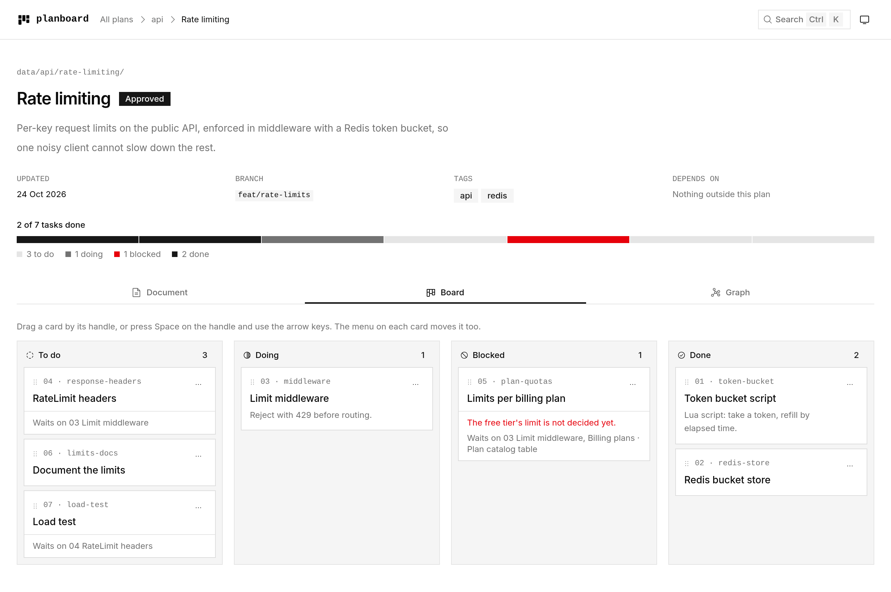
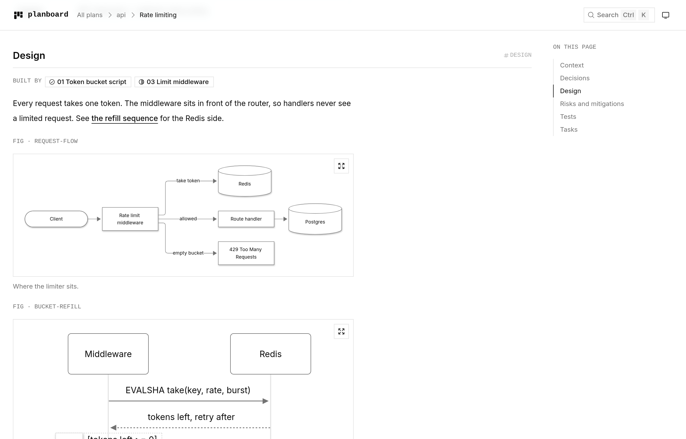
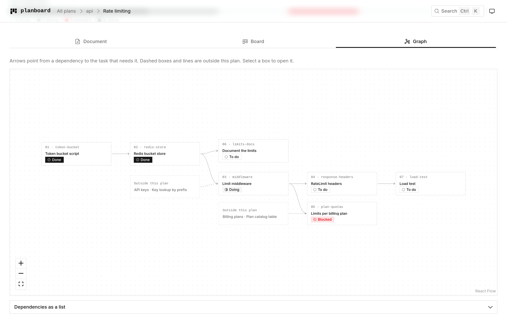

<h1 align="center">planboard</h1>

<p align="center">
  Implementation plans that live in your repository, as JSON.<br>
  Read and update them from the terminal, or open them in the browser as a document,<br>
  a kanban board and a dependency graph.
</p>

<p align="center">
  <picture>
    <source media="(prefers-color-scheme: dark)" srcset="docs/images/board-dark.png">
    <source media="(prefers-color-scheme: light)" srcset="docs/images/board-light.png">
    
  </picture>
</p>

## Why planboard

- **Plans next to the code.** A plan is a folder of JSON and Mermaid files, reviewed in
  pull requests and versioned with git. No external tracker to keep in sync.
- **One source, three views.** The same files render as a readable design document, a
  kanban board and a task dependency graph.
- **Safe edits.** Every change, from the CLI, the board or the Python API, is validated
  before it is written. A write that would break a plan is refused and nothing changes.
- **Built for coding agents.** `planboard skill install` teaches Claude Code, Codex,
  Cursor, Gemini CLI, GitHub Copilot and OpenCode to write plans, pick the next task and
  keep the board up to date.
- **Works offline.** The web app, Mermaid included, ships inside the package.

## Install

planboard needs Python 3.13 or later.

```bash
uv tool install planboard          # or: pipx install planboard
```

From a checkout of this repository: `uv tool install .`

## Quick start

<picture>
  <source media="(prefers-color-scheme: dark)" srcset="docs/images/cli-dark.gif">
  <source media="(prefers-color-scheme: light)" srcset="docs/images/cli-light.gif">
  
</picture>

```bash
cd my-project
planboard init                                           # planboard.toml, plans/, JSON Schemas
planboard new api/rate-limiting --title "Rate limiting"  # a plan from the template
planboard show api/rate-limiting                         # read it in the terminal
planboard task status api/rate-limiting#first-step doing
planboard next                                           # tasks whose dependencies are done
planboard serve                                          # http://localhost:8765
```

A plan looks like this on disk:

```
plans/api/rate-limiting/
  plan.json            title, status, tasks and their dependencies
  sections/*.json      the document, one file per section
  diagrams/*.mmd       Mermaid diagrams the sections show
```

The full file format is in [docs/format.md](docs/format.md).

## The web app

`planboard serve` opens the plans in your browser and reloads when a file changes on
disk. It follows your system's light or dark theme.

**Document.** Sections, tables, callouts, code and Mermaid diagrams, with the tasks that
build each section linked beside it.

<picture>
  <source media="(prefers-color-scheme: dark)" srcset="docs/images/document-dark.png">
  <source media="(prefers-color-scheme: light)" srcset="docs/images/document-light.png">
  
</picture>

**Board.** Drag a card to another column, or open it and pick a status. Moves go through
the same validated write as `planboard task status`, and work from the keyboard too.

**Graph.** Which task waits on which, including dependencies on tasks in other plans.

<picture>
  <source media="(prefers-color-scheme: dark)" srcset="docs/images/graph-dark.png">
  <source media="(prefers-color-scheme: light)" srcset="docs/images/graph-light.png">
  
</picture>

Press <kbd>Ctrl</kbd>+<kbd>K</kbd> to jump to a plan, a task or a view.

The server binds to `127.0.0.1` and rejects requests for any other host name, so a web
page cannot reach it through DNS rebinding.

## Coding agents

`planboard skill install` teaches your coding agents to read, track and write plans. It
supports Claude Code, Codex, Cursor, Gemini CLI, GitHub Copilot and OpenCode, and
behaves like `npx skills add` from [skills.sh](https://skills.sh): in a terminal it asks
which agents, project or global, and symlink or copy.

```bash
planboard skill install                          # asks; suggests the agents found
planboard skill install -a claude-code,codex -y  # chosen agents, this project
planboard skill install -g -y                    # the agents found, your home folder
planboard skill install --all                    # every supported agent, no questions
planboard skill install --list                   # the agents, their folders, which are found
planboard skill uninstall                        # remove them from this project; -g from home
```

A project install writes to `.agents/skills`, which Codex, Cursor, Gemini CLI, Copilot
and OpenCode read, and links `.claude/skills` to it; commit both. `-g` does the same in
your home folder. `--copy` writes real copies into each agent's folder instead of
symlinks. Run it again after an upgrade to update the skills.

| Skill | Does |
| --- | --- |
| `/planboard` | The commands, rules and format; `/planboard <mode>` runs a mode below |
| `/planboard-new` | Write a plan: context, decisions, design, diagrams, tasks |
| `/planboard-next` | Pick the next ready task, build it, track it on the board |
| `/planboard-status` | Report done, in progress, blocked and ready next |
| `/planboard-sync` | Bring task statuses in line with the code |

## Where plans live

Every command works on one plans folder. The first of these that applies wins:

1. `--data <dir>` on the command line, or the `PLANBOARD_DATA` environment variable.
2. The nearest `planboard.toml` in the current folder or a parent, like git finds its repo.
3. Your user data folder: `~/.local/share/planboard` on Linux,
   `~/Library/Application Support/planboard` on macOS, `%LOCALAPPDATA%\planboard` on
   Windows.

`planboard where` prints which folder is in use and why. `planboard init` writes:

```toml
# planboard workspace: paths are relative to this file.
plans = "plans"
schemas = "plans/.schema"
```

`schemas` is where the JSON Schemas go. Each plan file links its schema with a relative
`$schema` path, so editors validate plans as you type.

## Commands

Run `planboard --help`, or `planboard <command> --help`, for every option. A reference is
`folder/plan`, or `folder/plan#id` for a task, section or diagram. Shell completion fills
in references: run `planboard --install-completion` once.

| Read | Does |
| --- | --- |
| `outline [plan] [--tag]` | Every plan with its status and progress, or one plan's files, sections, diagrams and tasks |
| `show <plan>[#id]` | The plan as a terminal document, paged in a terminal, or one section, diagram or task of it |
| `board [plan] [--tag] [--status]` | Tasks by status, for all plans, one plan or a folder of plans |
| `next [plan] [--tag]` | Tasks in progress, then todo tasks whose dependencies are done; when none is ready, what each waits on |
| `search <words> [--limit]` | Fuzzy search across plans, tasks, sections and diagrams; typos are fine |
| `task show <plan#task>` | One task: what it waits on, what needs it, what finishing it readies, what it builds |
| `block list <plan#section>` | A section's blocks, numbered for `block set`, `move` and `rm` |
| `validate` | Every plan, reference, link and diagram; exits 1 on problems |

Every read command takes `--json`. `next --json` returns `ready`, `doing`, `blocked` and
`waiting` lists.

| Write | Does |
| --- | --- |
| `new <plan> [--title] [--summary] [--tags]` | A plan folder from the template |
| `plan set <plan>` | `--title`, `--summary`, `--status`, `--branch`, `--tags`, `--depends-on` |
| `plan mv <plan> <new>` | Move a plan to a new id, and its references to itself |
| `plan rm <plan>` | Delete a plan folder |
| `task status <plan#task> <status> [--note]` | Move a task to `todo`, `doing`, `blocked` or `done` |
| `task add <plan> <id> --title …` | Add a task; `--after`/`--before` place it |
| `task set <plan#task>` | `--title`, `--summary`, `--note`, `--depends-on`, `--sections`, `--diagrams` |
| `task rename <plan#task> <new-id>` | Rename a task and the dependencies on it in its plan |
| `task move <plan#task> --after/--before <id>` | Reorder the build order |
| `task rm <plan#task>` | Remove a task nothing depends on |
| `section add <plan> <id> --title … --text/--from` | Add a section, with a paragraph or JSON blocks |
| `section set <plan#section> [--title] [--from]` | Retitle a section, or replace its blocks from JSON |
| `section rename <plan#section> <new-id>` | Rename the id, the file, task links and `#links` |
| `section move` / `section rm` | Reorder, or remove a section no task builds |
| `block add <plan#section> <type> …` | Add a text, heading, list, table, callout, code or diagram block; `--at` places it |
| `block set <plan#section> <n> …` | Change a block's fields, or replace it with `--json` |
| `block move <plan#section> <n> --to <m>` / `block rm` | Reorder or remove a block |
| `diagram add <plan> <id> --alt … --source/--from` | Write `diagrams/<id>.mmd`; `--section` shows it |
| `diagram set` / `diagram rename` / `diagram rm` | Change the alt text or source; rename it everywhere; remove it with its blocks |

List options are comma-separated and an empty string clears an optional field:
`--depends-on "#a,auth/api-keys"`, `--note ""`. Table cells are `|`-separated:
`--columns "Decision | Why"`. `--from -` reads from stdin.

```bash
planboard block add api/rate-limiting#decisions table --columns "Decision | Why" \
  --row "Token bucket | Allows short bursts"
planboard block add api/rate-limiting#design callout --title "Limits" --text "Per key." --at 1
planboard block set api/rate-limiting#design 2 --caption "How a request is checked."
```

Every write validates the whole plan in memory first and is refused, with nothing written,
if the result would be invalid, or if it would break a reference or link in any plan, such
as removing or renaming a task another plan depends on. `--force` writes it anyway. A
write rewrites only the files it changed, stamps `updated`, then prints anything
`validate` reports across all plans. Every write takes `-n/--dry-run` to check a change
and list the files it would touch. The `rm` commands ask for confirmation in a terminal;
`-y/--yes` skips it.

| Workspace | Does |
| --- | --- |
| `init [dir] [--plans] [--schemas]` | Start a workspace: `planboard.toml`, the plans folder and its schemas |
| `where` | Which plans folder commands use, and why |
| `serve [--host] [--port] [--no-open]` | Serve the web app |
| `schema [--check]` | Rewrite the workspace's JSON Schemas from the installed models |
| `skill install [-a] [-g] [--all] [--copy]` | Install the agent skills; see [Coding agents](#coding-agents) |
| `skill uninstall [-a] [-g]` | Remove them, and links left pointing at nothing |

| Global option | Does |
| --- | --- |
| `--data <dir>` | Use this plans folder (also `PLANBOARD_DATA`) |
| `-q`, `--quiet` | Print only data and errors |
| `--no-color` | Plain text (also `NO_COLOR`) |
| `--version` | Print the version |

Data goes to stdout and messages to stderr, so `planboard outline --json | jq` stays
clean. Exit codes: `0` done, `1` refused or problems found, `2` wrong usage.

## Python API

```python
import planboard
from planboard.domain.edits.tasks import set_task

workspace = planboard.open_workspace()  # same discovery as the CLI
for plan_id, task in workspace.ready():
    print(f"{plan_id}#{task.id}", task.title)

workspace.set_task_status("api/rate-limiting", "first-step", "done")
workspace.edit(
    "api/rate-limiting",
    lambda draft: set_task(draft, "middleware", {"note": "Why."}),
)
```

`Workspace` holds every use case; [docs/architecture.md](docs/architecture.md) explains
the layers and how to plug in another store.

## Development

```bash
uv sync                    # creates .venv with the dev tools
uv run pytest
uv run ruff check && uv run ruff format
uv run pyright
uv build                   # builds the web app with bun, then sdist and wheel into dist/
```

The web app lives in `frontend/` and needs [bun](https://bun.sh):

```bash
cd frontend
bun install
bun run build              # into src/planboard/adapters/web/static/ for planboard serve
bun run dev                # hot reload; proxies /api to planboard serve on :8765
bun run lint && bun run typecheck
```

The README's screenshots and terminal recordings come from a fictional demo workspace.
`docs/demo/record.sh` rebuilds them in `docs/images/`; it needs
[VHS](https://github.com/charmbracelet/vhs) and a Chromium for Playwright (set
`CHROMIUM` to use an installed one).

## License

[MIT](LICENSE)
